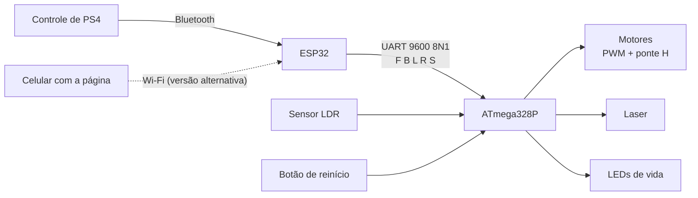
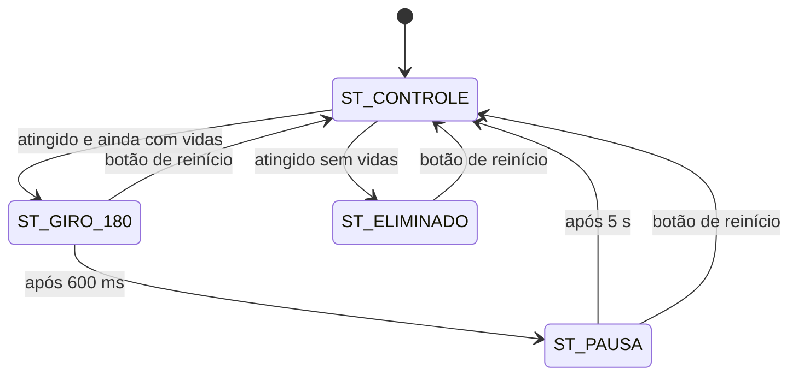

# Gigantes de MDF

Robô de combate de MDF desenvolvido para a disciplina **Programação de Hardware 2026**. Ele é controlado à distância por um **controle de PS4 (DualShock 4) via Bluetooth** ou, como alternativa sem biblioteca externa, por uma **página web pelo Wi-Fi do ESP32**. Ele usa um **laser** para atingir o adversário e um **sensor LDR** para detectar quando é atingido. As vidas são mostradas em LEDs.

> **Equipe:** _(preencher com os nomes dos integrantes do grupo)_

## Sumário

1. [Visão geral](#visão-geral)
2. [Estrutura do repositório](#estrutura-do-repositório)
3. [Hardware](#hardware)
4. [Como o software funciona](#como-o-software-funciona)
5. [Como compilar e gravar](#como-compilar-e-gravar)
6. [Como parear o controle](#como-parear-o-controle)
7. [Calibração](#calibração)
8. [Documentação do software (Doxygen)](#documentação-do-software-doxygen)
9. [Dependências externas](#dependências-externas)
10. [Estado do projeto](#estado-do-projeto)

## Visão geral

O robô tem duas placas que conversam por uma ligação serial:

Há duas versões do ESP32, e **só uma é usada por vez**. O ATmega328P é o mesmo nas duas.



- **ESP32:** recebe o comando e o converte em 1 caractere para o ATmega. Na versão com controle (`esp32/controle_ps4/my_platform.c`) o comando vem do controle de PS4 por Bluetooth. Na versão com site (`esp32/site_wifi/main.c`) ele vem de uma página web pelo Wi-Fi.
- **ATmega328P** (`atmega/main.c`): executa os comandos, aciona os motores, pisca o laser, lê o LDR e controla as vidas.

### Regras do robô

- O laser pisca **1 s ligado e 1 s desligado**.
- Cada robô começa com **3 vidas**, mostradas em 3 LEDs.
- Quando o LDR detecta o laser adversário, o robô perde uma vida, **gira 180°** e fica **5 s parado**, com motores e receptor desativados.
- Sem vidas, o robô fica **eliminado** até o botão de reinício ser apertado.

## Estrutura do repositório

```
.
├── atmega/main.c        # Firmware do ATmega328P (avr-gcc)
├── esp32/
│   ├── controle_ps4/my_platform.c  # ESP32 com controle de PS4 (ESP-IDF + Bluepad32)
│   └── site_wifi/main.c            # ESP32 com Wi-Fi e site de controle (só ESP-IDF)
├── Doxyfile                        # Configuração da documentação do software
├── .gitignore
└── README.md
```

Use **uma** das duas versões do ESP32. A do site existe para o caso de a biblioteca Bluepad32 não poder ser usada.

## Hardware

### Componentes

- ESP32 comum (por exemplo ESP32-WROOM-32D). Os modelos C3, S2 e S3 **não** funcionam com controle de PS4 (a versão do site funciona em qualquer modelo com Wi-Fi).
- ATmega328P a 16 MHz (Arduino Uno/Nano ou equivalente).
- Ponte H e dois motores DC.
- Laser, sensor LDR com divisor de tensão, 3 LEDs com resistor e 1 botão.
- Controle de PS4 (DualShock 4), se for usada a versão com controle.

### Ligações

| Função | Pino do ATmega328P | Observação |
|---|---|---|
| Recepção serial (do ESP32) | PD0 (RX) | Ligado ao GPIO17 do ESP32 |
| PWM do motor esquerdo | PD6 (OC0A) | |
| Direção do motor esquerdo | PD7 e PB0 | |
| PWM do motor direito | PD5 (OC0B) | |
| Direção do motor direito | PD4 e PB4 | |
| Laser | PB2 (OC1B) | |
| Sensor LDR | PC0 (ADC0) | |
| LEDs de vida | PC1, PC2, PC3 | |
| Botão de reinício | PD2 (INT0) | Para o GND, com pull-up interno |

| Função | Pino do ESP32 |
|---|---|
| TX da UART2 (para o ATmega) | GPIO17 |

O **GND** do ESP32, do ATmega e da ponte H deve ser comum. Se o Arduino estiver ligado ao PC pelo USB, desconecte o fio do ESP32 do RX durante a gravação, porque o RX é compartilhado com o USB.

## Como o software funciona

### Protocolo serial (ESP32 → ATmega328P)

Uma UART a 9600 bps, 8N1, com **1 caractere por comando**:

| Caractere | Ação |
|---|---|
| `F` | Frente |
| `B` | Ré |
| `L` | Giro para a esquerda |
| `R` | Giro para a direita |
| `S` | Parar |

### ESP32 com controle (`esp32/controle_ps4/my_platform.c`)

- O comando é lido do **D-pad** (prioridade) ou do **analógico esquerdo**.
- Enquanto algo estiver apertado, o comando é **reenviado a cada 100 ms**. Ao soltar, o ESP32 envia `S`. Se o controle desconectar, o robô para.

### ESP32 com site (`esp32/site_wifi/main.c`)

- O ESP32 cria uma rede Wi-Fi própria (modo Access Point) chamada `GigantesMDF`, com a senha `gigante123`.
- O celular conecta nessa rede e abre `http://192.168.4.1`, que mostra uma página com 4 setas.
- Enquanto uma seta está apertada, a página chama `/cmd?c=X` a cada 100 ms, e o ESP32 repassa o caractere ao ATmega. Ao soltar, a página envia `S`.
- O ESP32 só aceita os caracteres `F`, `B`, `L`, `R` e `S`.

### Firmware do ATmega328P (`atmega/main.c`)

| Periférico | Uso |
|---|---|
| Timer0 | PWM dos motores (OC0A e OC0B) |
| Timer1 | Laser em OC1B, 1 s ligado e 1 s desligado |
| Timer2 | Base de tempo de 1 ms (interrupção) |
| ADC0 | Leitura do LDR |
| INT0 | Botão de reinício |
| USART0 | Comandos do ESP32 |

**Parada de segurança:** se o robô estiver em movimento e passar 300 ms sem receber comando, os motores são parados. Assim, um `S` perdido não deixa o robô sem controle.

**Máquina de estados:**



| Estado | O que acontece |
|---|---|
| `ST_CONTROLE` | Aceita comandos do ESP32 e monitora o LDR |
| `ST_GIRO_180` | Gira 180° e ignora comandos e o LDR |
| `ST_PAUSA` | Fica 5 s parado, com motores e receptor desativados |
| `ST_ELIMINADO` | Sem vidas, laser desligado, aguarda o botão |

## Como compilar e gravar

### ATmega328P

Requer `avr-gcc` e `avrdude`. Em uma pasta com o `main.c`:

```bash
avr-gcc -mmcu=atmega328p -Os -o robo.elf main.c
avr-objcopy -O ihex robo.elf robo.hex
avrdude -p m328p -c arduino -P /dev/ttyACM0 -b 115200 -U flash:w:robo.hex
```

Troque `/dev/ttyACM0` pela porta do seu Arduino (no Windows, algo como `COM3`).

### ESP32 com controle (Bluepad32)

1. Instale o **ESP-IDF 5.5 ou mais novo**. A Bluepad32 pede essa versão.
2. Baixe a Bluepad32 e aplique os patches:

   ```bash
   git clone --recursive https://github.com/ricardoquesada/bluepad32.git
   cd bluepad32/external/btstack && git apply ../patches/*.patch
   ```

3. Entre em `bluepad32/examples/esp32`. Troque `main/my_platform.c` pelo arquivo `esp32/controle_ps4/my_platform.c` deste repositório. Se o `main/CMakeLists.txt` tiver uma lista `REQUIRES`, acrescente `driver` nela.
4. Rode `idf.py set-target esp32`, depois `idf.py build flash monitor`.

### ESP32 com site (sem biblioteca externa)

Requer apenas o **ESP-IDF** (qualquer versão 4.x ou 5.x). Em um projeto ESP-IDF novo:

```bash
idf.py create-project robo_site
# substitua robo_site/main/main.c por esp32/site_wifi/main.c
cd robo_site
idf.py set-target esp32
idf.py build flash monitor
```

Depois de gravar, conecte o celular em `GigantesMDF` e abra `http://192.168.4.1`.

## Como parear o controle

Vale só para a versão com controle. Com o ESP32 ligado e rodando, segure **SHARE + PS** no controle de PS4 até a luz piscar rápido. Em alguns segundos ele conecta sozinho. Nas próximas vezes, basta apertar o botão **PS**.

## Calibração

Estes valores devem ser ajustados com o robô montado:

| Parâmetro | Arquivo | Padrão | O que faz |
|---|---|---|---|
| `TEMPO_GIRO_180_MS` | `atmega/main.c` | 600 ms | Duração do giro de 180° |
| `LDR_LIMIAR` | `atmega/main.c` | 700 | Leitura do ADC (0 a 1023) a partir da qual há laser |
| `VELOCIDADE_AVANCO` | `atmega/main.c` | 200 | Velocidade de frente, ré e giro manual |
| `VELOCIDADE_GIRO` | `atmega/main.c` | 200 | Velocidade do giro automático |
| `COMP_E` e `COMP_D` | `atmega/main.c` | 100 % | Compensação entre os motores |
| `TEMPO_SEM_CMD_MS` | `atmega/main.c` | 300 ms | Tempo sem comando até parar |
| `LIMIAR_STICK` | `esp32/controle_ps4/my_platform.c` | 250 | Sensibilidade do analógico |

Se o robô andar ao contrário ou girar para o lado errado, inverta os fios do motor correspondente.

## Documentação do software (Doxygen)

Todo o código-fonte está comentado no padrão **Doxygen** (`@file`, `@brief`, `@param`, `@return`). Para gerar a documentação em HTML:

```bash
doxygen Doxyfile
```

Depois abra `docs/html/index.html` no navegador. A saída em `docs/html` não é versionada (está no `.gitignore`); gere-a localmente. Para os gráficos de chamadas, o Graphviz (`dot`) precisa estar instalado.

## Dependências externas

- **[Bluepad32](https://github.com/ricardoquesada/bluepad32):** biblioteca usada **apenas** na versão com controle, para ler o controle Bluetooth. O arquivo `esp32/controle_ps4/my_platform.c` é o código do grupo que roda sobre ela. A versão `esp32/site_wifi/main.c` não usa essa biblioteca.
- **ESP-IDF** (Espressif) e **avr-libc** (`avr-gcc`): SDKs e bibliotecas padrão de cada placa.

## Estado do projeto

O código foi escrito e revisado, mas **ainda precisa ser validado no robô**: o pareamento do controle (ou a conexão ao Wi-Fi), a calibração do giro e do LDR e a pinagem da ponte H dependem da montagem real.
